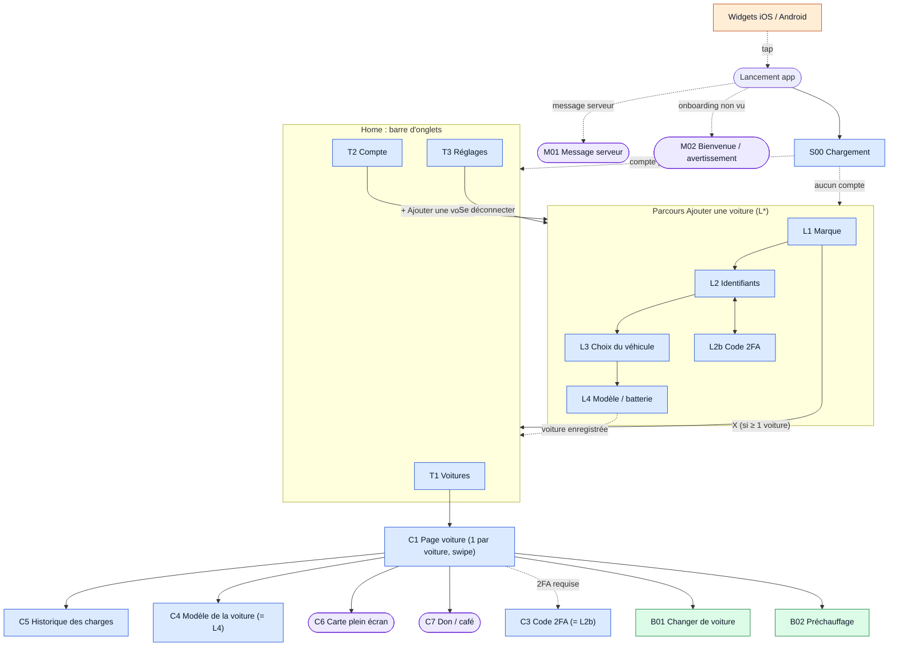
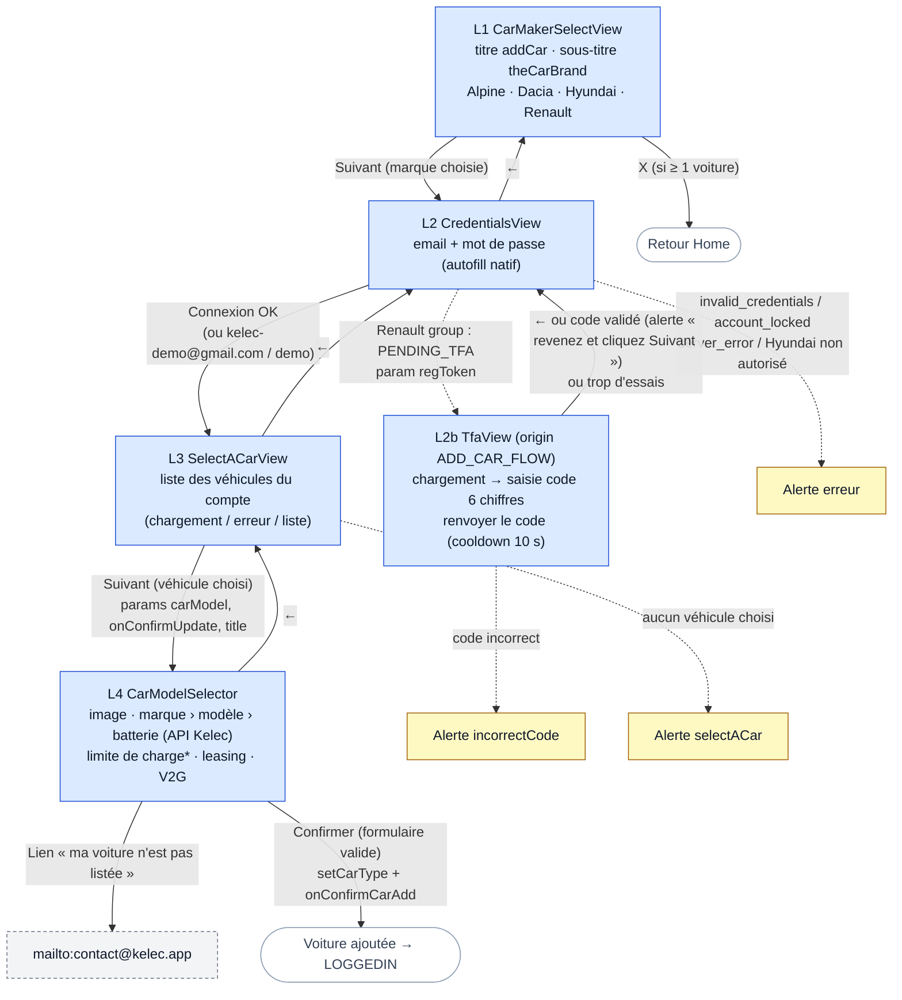
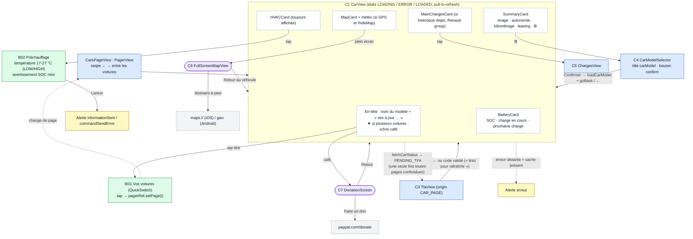
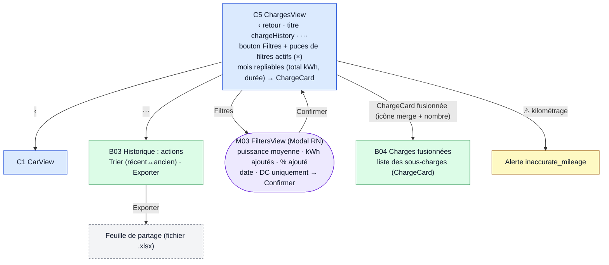
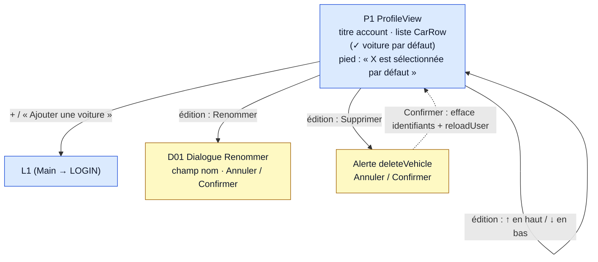
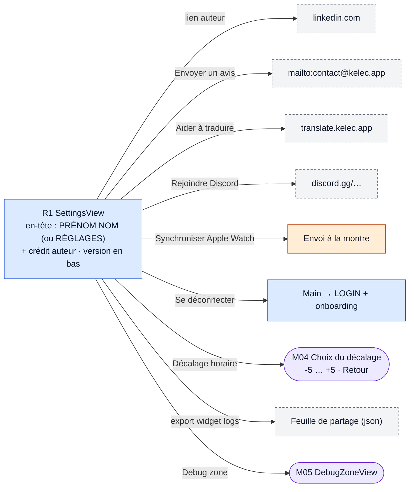
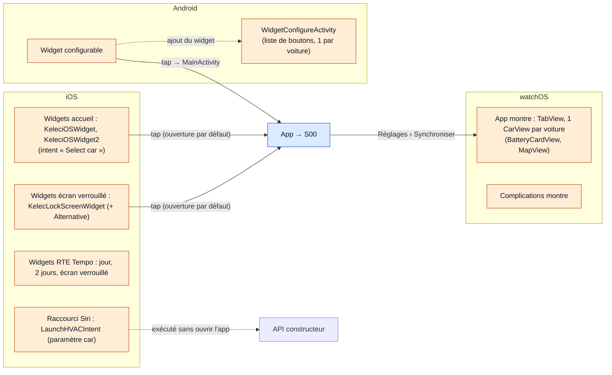

# Cartographie des écrans — Kelec

> Carte de **tous les écrans, modales, bottom sheets et sorties externes** de l'app, avec les liens de navigation
> (qui ouvre qui, avec quels paramètres, sous quelles conditions).
> Objectif double : **comprendre** l'app existante et servir de **spécification** pour une réécriture from scratch conforme.
>
> Établi le 2026-10-07 sur la branche `fix-safe-area` (version 2.6.5). Les diagrammes sont en [Mermaid](https://mermaid.js.org/)
> (rendu natif sur GitHub et dans IntelliJ avec le plugin Mermaid).

---

## Sommaire

1. [Légende](#1-légende)
2. [Vue d'ensemble](#2-vue-densemble)
3. [Hiérarchie des conteneurs de navigation](#3-hiérarchie-des-conteneurs-de-navigation)
4. [Machine à états racine](#4-machine-à-états-racine-main)
5. [Parcours « Ajouter une voiture »](#5-parcours--ajouter-une-voiture-)
6. [Onglet Voitures : page voiture](#6-onglet-voitures--page-voiture)
7. [Historique des charges](#7-historique-des-charges)
8. [Onglet Compte](#8-onglet-compte)
9. [Onglet Réglages](#9-onglet-réglages)
10. [Points d'entrée hors app (widgets, Siri, montre)](#10-points-dentrée-hors-app)
11. [Catalogue des écrans (fiches)](#11-catalogue-des-écrans-fiches)
12. [Spécification de navigation pour une réécriture](#12-spécification-de-navigation-pour-une-réécriture)
13. [Parcours utilisateurs de référence (recette)](#13-parcours-utilisateurs-de-référence-recette)
14. [Particularités et incohérences à connaître](#14-particularités-et-incohérences-à-connaître)

---

## 1. Légende

| Forme / couleur | Type | Implémentation actuelle |
|---|---|---|
| 🟦 rectangle bleu | **Écran** (route d'un navigateur ou vue racine) | `Stack.Screen`, `Tab.Screen`, vue de `Main` |
| 🟪 rectangle violet arrondi | **Modale plein écran** | `presentation: 'modal'` (stack) ou `KModal` / `Modal` RN |
| 🟩 vert | **Bottom sheet** (feuille du bas) | `screen/Common/bottomSheet/BottomSheet` |
| 🟨 jaune | **Alerte / dialogue système** | `Alert.alert`, `react-native-dialog` |
| ⬜ gris pointillé | **Sortie externe** (autre app, URL, partage) | `Linking.openURL`, `Share.share` |
| 🟧 orange | **Point d'entrée natif** (widget, Siri, montre) | Swift / Kotlin |

Flèche pleine = navigation déclenchée par l'utilisateur. Flèche pointillée = navigation automatique (résultat d'un appel, état).

---

## 2. Vue d'ensemble



---

## 3. Hiérarchie des conteneurs de navigation

Il n'y a **pas de navigateur racine unique** : `Main` choisit une vue selon un état, et chaque sous-arbre possède son
propre `NavigationContainer` (isolé par `NavigationIndependentTree`).

```
index.js
└─ App.tsx  ── ThemeProvider(useAutoTheme) › SafeAreaProvider › NavigationBar + StatusBar
   └─ Main.tsx  ── MainContext.Provider, AppErrorBoundary
      ├─ [overlay] KModal  M01 Message serveur          (si api.kelec.app/messages/{version} renvoie un texte)
      ├─ [overlay] KModal  M02 WelcomeScreen             (si !hasSeenLoginOnboarding)
      └─ switch(currentView)
         ├─ LOADING   → S00 FullScreenLoading
         ├─ LOGIN     → LoginEntryView
         │              └─ NavigationIndependentTree › NavigationContainer › NativeStack (headerShown:false)
         │                 ├─ CarMakerSelectView   (L1, route initiale)
         │                 ├─ CredentialsView      (L2)
         │                 ├─ TfaView              (L2b)
         │                 ├─ SelectACarView       (L3)
         │                 └─ CarModelSelector     (L4)
         └─ LOGGEDIN  → Home
                        └─ NavigationContainer › BottomTabs (headerShown:false)
                           ├─ « cars »     → CarsView (CarsViewContext : overlay sombre des modales)
                           │                 ├─ 0 voiture → S01 « No car »
                           │                 └─ CarsPageView › PagerView (1 page par voiture, swipe horizontal)
                           │                    └─ [par voiture] NavigationIndependentTree › NavigationContainer › NativeStack
                           │                       ├─ CarView           (C1, route initiale)
                           │                       ├─ TfaView           (C3)
                           │                       ├─ ChargesView       (C5)
                           │                       ├─ CarModelSelector  (C4)
                           │                       ├─ DonationScreen    (C7, presentation: modal)
                           │                       └─ MapView           (C6, presentation: modal)
                           ├─ « account »  → ProfileView  (P1)
                           └─ « settings » → SettingsView (R1)
```

> ⚠️ Les noms des onglets sont **les traductions** de `cars` / `account` / `settings`, et l'icône est choisie en
> comparant `route.name` à la traduction.

---

## 4. Machine à états racine (`Main`)

```mermaid
stateDiagram-v2
    [*] --> LOADING
    LOADING --> LOGGEDIN : loadAccount() ≠ null<br/>(clés account + kelecNextGen)
    LOADING --> LOGIN : pas de compte

    LOGIN --> LOGGEDIN : L4 confirmé → saveAccount + reloadUser
    LOGIN --> LOGGEDIN : X sur L1 (seulement si ≥ 1 voiture)
    LOGGEDIN --> LOGIN : Compte › « Ajouter une voiture »
    LOGGEDIN --> LOGIN : Réglages › « Se déconnecter »<br/>(AsyncStorage.clear → l'onboarding réapparaît)
    LOGGEDIN --> LOGGEDIN : suppression d'une voiture<br/>(reloadUser ; 0 voiture → écran « No car »)

    state "Overlays indépendants de l'état" as OV {
        M01_Message : bloquant, pas de bouton de fermeture
        M02_Onboarding : case « Je comprends » + « C'est parti »
    }
```



- Chaque passage `LOGIN ⇄ LOGGEDIN` **remonte entièrement** l'arbre cible : on revient sur l'onglet Voitures, page 0, et le
  parcours d'ajout repart de L1.
- `setCurrentView` est exposé dans `MainContext` et appelé directement par `ProfileView` et `LoginDefaultView`.

---

## 5. Parcours « Ajouter une voiture »



\* le slider « limite de charge » n'apparaît que si le modèle choisi fait partie de `AUTHORISED_MODELS`.
Les champs du leasing (dates début/fin, kilométrage total, kilométrage au départ) n'apparaissent que si l'interrupteur
leasing est activé, et ils deviennent alors obligatoires.

**État partagé du parcours** (porté par `LoginEntryView`, pas par les params de route) : `selectedCarMaker`, `account`,
`selectedCar`. Le gabarit commun à toutes les étapes est `LoginDefaultView` : titre, sous-titre, texte d'aide, contenu
scrollable, bouton ← (neutral) et bouton Suivant (primary) collés en bas, croix optionnelle.

---

## 6. Onglet Voitures : page voiture



Logique de chargement de C1 : cache AsyncStorage + cache widget natif (`{vin}_batteryStatus`) → affichage immédiat →
appels API (status, cockpit, localisation, charges, réglages de charge, HVAC) → mise à jour + `refreshWidget`.
Sans cache, une erreur distante affiche l'écran d'erreur plein écran (`FullScreenError`).

---

## 7. Historique des charges



---

## 8. Onglet Compte



---

## 9. Onglet Réglages



Interrupteurs (sans navigation) : `hideMap` (section Affichage) ; `useMiles`, `convertToMiles` (visible seulement si
useMiles), `colourDCCharging`, `displayChargingPower`, `mergeCharges` (section Voiture). Tous persistent dans
`AppPreferences`.

---

## 10. Points d'entrée hors app



Aucun deep link n'est géré : tous les points d'entrée ouvrent l'app sur son état normal (S00 → C1 page 0).

---

## 11. Catalogue des écrans (fiches)

### Vues racine et overlays

| ID | Nom | Fichier | Type | Ouvert par | Mène à | testID |
|---|---|---|---|---|---|---|
| S00 | Chargement | `src/FullScreenLoading.tsx` | vue racine | lancement | C1 ou L1 | — |
| S01 | Aucune voiture | `CarsTab/CarsView.tsx` | état de T1 | 0 voiture après suppression | (rien, utiliser Compte) | `carsView` |
| M01 | Message serveur | `src/Main.tsx` | KModal fade, **bloquante** | `GET /messages/{version}?language=` non vide | — | `messageView` |
| M02 | Bienvenue | `src/WelcomeScreen.tsx` | KModal slide | `hasSeenLoginOnboarding` absent | fermeture (case obligatoire) | `checkbox0`, `letsGoButton` |
| — | Erreur plein écran | `src/FullScreenError.tsx` | composant d'état | C1, L3 en erreur | — | — |

### Parcours d'ajout (stack `LoginEntryView`)

| ID | Route | Fichier | Params | Entrées | Sorties | testID clés |
|---|---|---|---|---|---|---|
| L1 | `CarMakerSelectView` | `kelec-login/views/Steps/Step1/CarMakerSelectView.tsx` | — | route initiale | L2 ; X → Home | `carMakerSelectView`, `{BRAND}Logo`, `nextStepButton`, `addBackButton` |
| L2 | `CredentialsView` | `Step2/CredentialsView.tsx` | (marque via état du parcours) | L1, retour de L2b | L3, L2b, alertes | `credentialsStepView`, `emailInput`, `passwordInput`, `loginButton`, `previousButton` |
| L2b | `TfaView` | `Step2/Tfa/TfaView.tsx` (+ `TfaCodeView`) | `regToken`, `origin` | L2 | retour L2 | `TfaView`, `resendCodeButton`, `tfaNextButton`, `TFAErrorPopUp` |
| L3 | `SelectACarView` | `Step3/SelectACarView.tsx` (+ `CarSelector`) | `account` | L2 | L4, retour L2 | `addViewSelector`, `carRowCard`, `addSelectedCarButton` |
| L4 | `CarModelSelector` | `Step4/CarModelSelector.tsx` (+ `DropDownView`, `ChargeLimitSlider`, `CarModelChoiceLeasing`) | `carModel`, `onConfirmUpdate`, `title`, `subTitle?`, `nextButtonText?`, `safeAreaEdges?` | L3, C1 (⚙) | confirmation, retour | `carModelChoiceStep`, `brandDropdown`, `modelDropdown`, `batteryDropdown`, `chargingLimitSlider`, `leasingSwitch`, `V2GCompatibleSwitch`, `carNotListedButton`, `confirmCarModelChoice` |

### Home (onglets)

| ID | Onglet | Fichier | Icône | testID |
|---|---|---|---|---|
| T1 | `cars` | `loggedIn/CarsTab/CarsView.tsx` | `directions-car` | `bottomButtondirections-car` |
| T2 | `account` | `loggedIn/ProfileTab/ProfileView.tsx` | `person` | `bottomButtonperson` |
| T3 | `settings` | `loggedIn/SettingsTab/SettingsView.tsx` | `settings` | `bottomButtonsettings` |

### Stack voiture (un par voiture)

| ID | Route / composant | Fichier | Type | Params | Ouvert par | testID clés |
|---|---|---|---|---|---|---|
| C1 | `CarView` | `CarsTab/CarView/CarView.tsx` | écran (initial) | props `carModel`, `account`, `pagerRef`, `tfaInProgress` | PagerView | `carViewTitle`, `lastUpdateText`, `carChoiceButton`, `openCoffeeModal`, `summaryCard`, `ChargesCard` |
| C3 | `TfaView` | = L2b | écran | `regToken`, `origin: CAR_PAGE` | auto (PENDING_TFA) | idem L2b |
| C4 | `CarModelSelector` | = L4 | écran | `title: carModel`, `nextButtonText: confirm`, `safeAreaEdges: ['top']` | ⚙ de SummaryCard (`openModalButton`) | idem L4 |
| C5 | `ChargesView` | `CarView/ChargesView.tsx/ChargesView.tsx` | écran | (`charges`, `carType` passés mais non typés) | MainChargesCard | `ChargesView`, `backButton`, `openModal`, `showFiltersButton`, `filterListButton` |
| C6 | `MapView` | `CarView/Elements/Map/FullScreenMapView.tsx` | modale stack | `latitude`, `longitude`, `lastMapUpdateDate`, `image`, `weatherHandler`, `carModel` | MapCard (`fullScreenButton`) | — |
| C7 | `DonationScreen` | `CarView/Elements/SendCoffee.tsx` | modale stack | — | icône café | — |

### Bottom sheets, modales locales, dialogues

| ID | Nom | Fichier hôte | Déclencheur | Contenu / actions | testID |
|---|---|---|---|---|---|
| B01 | Vos voitures | `CarView.tsx` → `QuickSwitchView` | tap sur le titre | liste des voitures → `setPage(i)` | `carChoiceModal` |
| B02 | Préchauffage | `Elements/HVACCard.tsx` | tap sur la carte | − / température / +, alerte SOC, « Lancer » | `temperatureText`, `degreeText`, `hvacIcon` |
| B03 | Actions historique | `ChargesView.tsx` | ⋯ | trier, exporter xlsx | `chargesViewModal`, `sortButton`, `exportButton` |
| B04 | Charges fusionnées | `ChargeCard.tsx` | icône merge | sous-charges (ChargeCard récursif) | `mergeViewBottomSheet`, `mergeChargeDetailsButton` |
| M03 | Filtres | `ChargesView.tsx` → `FiltersView` | bouton Filtres | 5 filtres + Confirmer | `filtersView`, `confirmButton` |
| M04 | Décalage horaire | `SettingsView.tsx` | ligne « timezoneOffset » | -5 … +5, Retour | `timezoneOffsetButton{i}`, `addBackButton` |
| M05 | Debug zone | `SettingsTab/DebugZone/DebugZoneView.tsx` | ligne « Debug zone » | outils de debug, Close | — |
| D01 | Renommer | `ProfileTab/RenameModal.tsx` | « Renommer » (mode édition) | champ + Annuler/Confirmer | `carNameInput`, `carNameModalCancel`, `carNameModalConfirm` |
| A* | Alertes système | divers | erreurs, confirmations | voir diagrammes | — |

### Sorties externes

| Depuis | Cible |
|---|---|
| L4 « ma voiture n'est pas listée » | `mailto:contact@kelec.app?subject=Kelec new model` |
| C7 « Faire un don » | `https://www.paypal.com/donate/?hosted_button_id=…` |
| C6 « Itinéraire à pied » | `maps://0,0?q={modèle}@{lat},{lng}` (iOS) / `geo:0,0?q={lat},{lng}({modèle})` (Android) |
| B03 « Exporter » | feuille de partage, fichier `export{timestamp}.xlsx` |
| R1 | mailto feedback, `translate.kelec.app`, Discord, LinkedIn de l'auteur, partage `exportLogs.json` |

---

## 12. Spécification de navigation pour une réécriture

### 12.1 Arborescence cible (proposition conforme au comportement actuel)

On garde les mêmes écrans et les mêmes transitions, mais avec **un seul `NavigationContainer`** et une navigation
conditionnée par l'authentification (pattern « auth flow » de React Navigation) :

```
RootStack (NavigationContainer unique)
├─ [si !hasSeenOnboarding]  Onboarding            (M02, modal plein écran, non fermable sans la case)
├─ [si serverMessage]       ServerMessage         (M01, modal transparente, bloquante)
├─ [si cars.length == 0 ou flux d'ajout ouvert]  AddCarStack
│   ├─ CarMaker          (L1)
│   ├─ Credentials       (L2)
│   ├─ Tfa               (L2b)
│   ├─ SelectCar         (L3)
│   └─ CarModel          (L4)
└─ [sinon] MainTabs
    ├─ CarsTab → CarsStack
    │   ├─ CarPager          (C1 × n, PagerView ; index courant dans l'état)
    │   ├─ Tfa               (C3)
    │   ├─ Charges           (C5)
    │   ├─ CarModel          (C4)
    │   ├─ ChargeFilters     (M03, presentation: modal)
    │   ├─ Map               (C6, presentation: modal)
    │   └─ Donation          (C7, presentation: modal)
    ├─ AccountTab  (P1)
    └─ SettingsTab (R1)
        ├─ TimezoneOffset (M04, modal)
        └─ DebugZone      (M05, modal, __DEV__ ou build interne)
```

Les bottom sheets (B01‑B04), le dialogue D01 et les alertes restent des **composants locaux** à leur écran.

### 12.2 Types des routes (TypeScript)

```ts
type Vin = string;

export type AddCarStackParamList = {
  CarMaker: undefined;
  Credentials: { carMaker: CarMaker };
  Tfa: { regToken: string; origin: 'ADD_CAR_FLOW' | 'CAR_PAGE' };
  SelectCar: { accountId: string };            // l'Account est conservé dans un store, pas dans les params
  CarModel: { vin: Vin; mode: 'add' | 'edit' }; // remplace les callbacks onConfirmUpdate
};

export type CarsStackParamList = {
  CarPager: { initialVin?: Vin };
  Tfa: { regToken: string; origin: 'CAR_PAGE'; vin: Vin };
  Charges: { vin: Vin };
  ChargeFilters: { vin: Vin };
  CarModel: { vin: Vin; mode: 'edit' };
  Map: { vin: Vin };                           // coordonnées / météo relues depuis le store
  Donation: undefined;
};

export type MainTabsParamList = {
  CarsTab: NavigatorScreenParams<CarsStackParamList>;
  AccountTab: undefined;
  SettingsTab: undefined;
};
```

Règles : des params **sérialisables** uniquement (vin, ids), jamais de fonctions ni d'instances de classe (aujourd'hui
`onConfirmUpdate`, `CarModel`, `WeatherApiHandler` et `Account` passent par les params). Les noms de routes sont des
**identifiants techniques stables**, et le libellé traduit passe dans `options.title` / `tabBarLabel`.

### 12.3 Matrice des transitions

| De | Action | Vers | Condition | Effet |
|---|---|---|---|---|
| Lancement | — | MainTabs / AddCarStack | compte stocké avec ≥ 1 voiture / sinon | — |
| Lancement | — | Onboarding (par-dessus) | onboarding non vu | — |
| Lancement | — | ServerMessage (par-dessus) | message API non vide | — |
| L1 | Suivant | L2 | marque choisie | — |
| L1 | X | MainTabs | ≥ 1 voiture existante | annule le parcours |
| L2 | Connexion | L3 | identifiants valides ou compte démo | crée l'`Account` |
| L2 | Connexion | L2b | Renault/Dacia/Alpine : `pending_tfa` | `regToken` |
| L2 | Connexion | Alerte | `invalid_credentials`, `account_locked`, `server_error`, Hyundai non autorisé | — |
| L2b | Valider | L2 (retour) | code correct | l'utilisateur doit recliquer « Connexion » |
| L2b | Valider | L2 (retour) + alerte | trop d'essais | — |
| L3 | Suivant | L4 (`mode: add`) | véhicule choisi | — |
| L4 (add) | Confirmer | MainTabs | marque, modèle et batterie renseignés (+ leasing complet si activé) | `setCarType`, `saveAccount` |
| C1 | tap titre | B01 | toujours (▼ visible si ≥ 2 voitures) | — |
| B01 | tap voiture | C1 (autre page) | — | `setPage(i)` |
| C1 | ⚙ | L4 (`mode: edit`) | — | au retour : rechargement du CarType |
| C1 | café | C7 | — | — |
| C1 | carte charges | C5 | historique disponible (Renault group) | — |
| C1 | plein écran carte | C6 | GPS disponible et `!hideMap` | — |
| C1 | (auto) | C3 | `fetchCarStatus` → `pending_tfa`, aucune 2FA déjà en cours | — |
| C1 | tap HVAC | B02 | toujours | — |
| C5 | ⋯ / Filtres / merge | B03 / M03 / B04 | — | — |
| P1 | + | AddCarStack (L1) | — | — |
| P1 | Supprimer → Confirmer | P1 | — | efface identifiants chiffrés + compte |
| R1 | Se déconnecter | AddCarStack + Onboarding | — | `AsyncStorage.clear()` + compte widget vidé |
| R1 | Décalage horaire / Debug | M04 / M05 | — | — |

---

## 13. Parcours utilisateurs de référence (recette)

À rejouer sur une réécriture (ils correspondent aux tests d'intégration existants dans `__tests__/`) :

1. **Premier lancement** : onboarding → cocher « Je comprends » → « C'est parti » → L1 sans croix.
2. **Ajout démo** : L1 Renault → L2 `kelec-demo@gmail.com` / `demo` → L3 (2 voitures démo) → L4 choix marque/modèle/batterie → Home, onglet Voitures.
3. **Ajout avec 2FA** : L2 → L2b (code reçu par mail) → retour L2 → Connexion → L3 → L4 → Home.
4. **Erreurs de connexion** : mauvais mot de passe, compte verrouillé, erreur serveur → alerte, on reste sur L2.
5. **Multi-voitures** : swipe entre pages ; titre ▼ → B01 → sélection → la bonne page s'affiche.
6. **Édition du modèle** : C1 ⚙ → L4 pré-rempli → Confirmer → retour C1 mis à jour.
7. **Historique** : C1 → C5 → filtres → puces → suppression d'une puce → tri → export.
8. **Préchauffage** : C1 → B02 → réglage de la température (persistée par vin) → Lancer → alerte.
9. **Carte** : C1 → C6 → standard/hybride (persisté) → itinéraire externe → retour.
10. **2FA expirée sur la page voiture** : C1 → C3 automatique → retour → tirer pour rafraîchir.
11. **Compte** : mode édition, réordonner, renommer, définir par défaut, supprimer (jusqu'à 0 voiture → S01).
12. **Déconnexion** : R1 → L1 + onboarding de nouveau.

---

## 14. Particularités et incohérences à connaître

À reproduire volontairement ou à corriger dans une réécriture :

- **Plusieurs `NavigationContainer` indépendants** (login, Home, puis un par voiture) : `navigation` ne traverse ni les
  pages ni l'arbre de login. On bascule entre login et Home par un état React (`setCurrentView`), pas par la navigation.
- **2FA dans le parcours d'ajout** : après un code validé, on revient sur L2 et l'utilisateur doit **recliquer**
  « Connexion » (une alerte le lui dit). Une réécriture peut enchaîner directement sur L3.
- **M01 Message serveur** : `onClose` est vide, la modale est donc **bloquante** (fonctionne comme un kill switch).
- **`ChargesView`** est typée `undefined` dans `CarsViewParamList` mais reçoit `{charges, carType}` via `navigate`.
- **B01** s'ouvre même avec une seule voiture ; seule l'icône ▼ est conditionnée.
- **Modales hétérogènes** : `KModal` (M01, M02), `Modal` RN (M03, M04, M05, BottomSheet), stack modal (C6, C7),
  `react-native-dialog` (D01). La cible est `KModal` ou la présentation modale du stack.
- **Déconnexion** = `AsyncStorage.clear()` : l'onboarding et toutes les préférences sont effacés.
- **Suppression de la dernière voiture** : on reste connecté sur un écran « No car » brut (texte non traduit).
- **Onglets** nommés par leur traduction (voir §3).
- **DebugZone** importe `Common/BigButton`, qui n'existe plus.
- **Hyundai** : pas d'historique de charges (`shouldDisplayChargesCard() → false`), donc pas d'accès à C5.
- **Aucun deep link** : les widgets ouvrent l'app sur C1 page 0, pas sur la voiture du widget.
